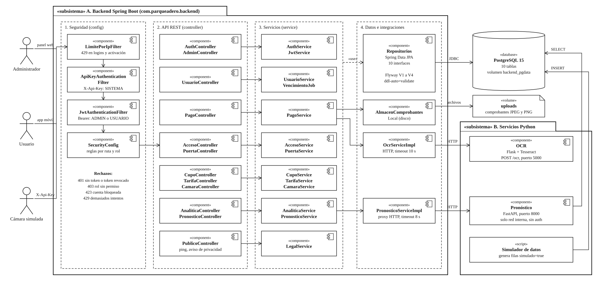
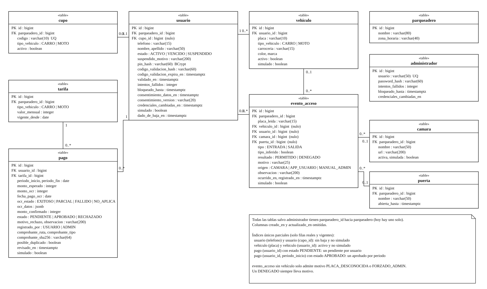
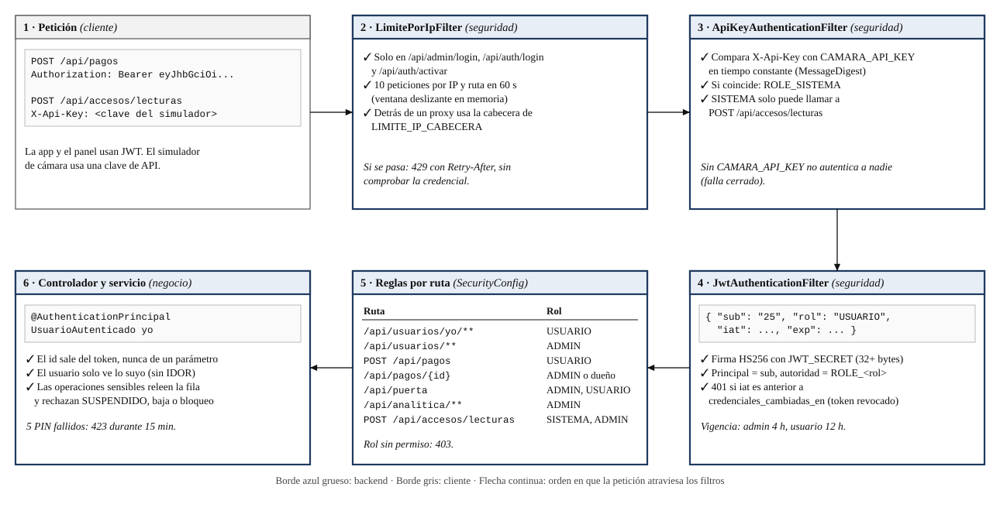
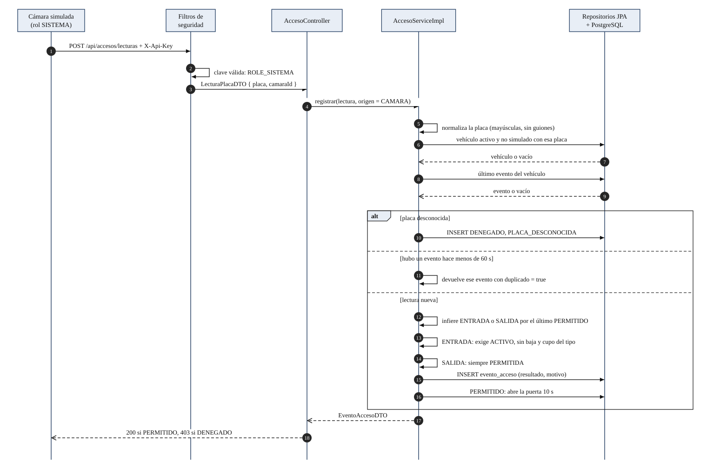
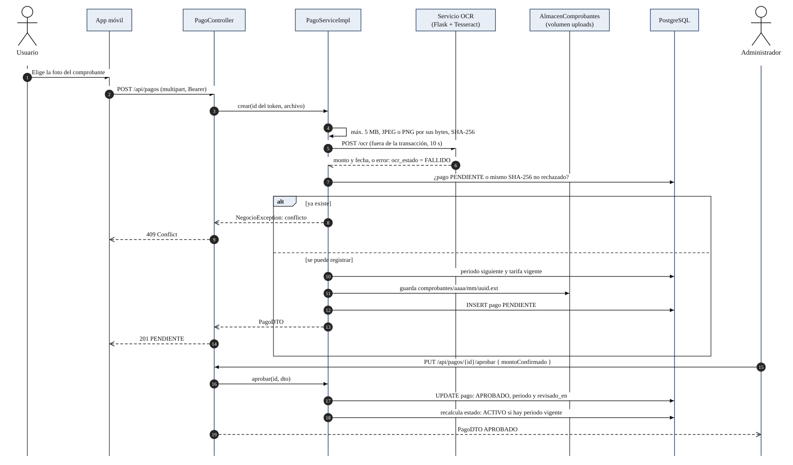
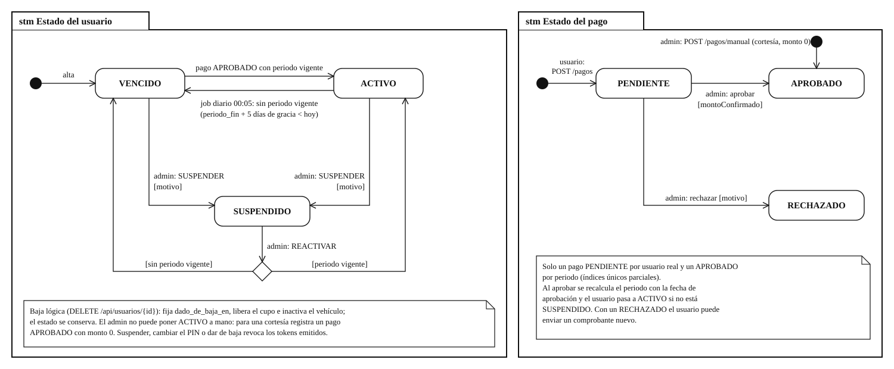
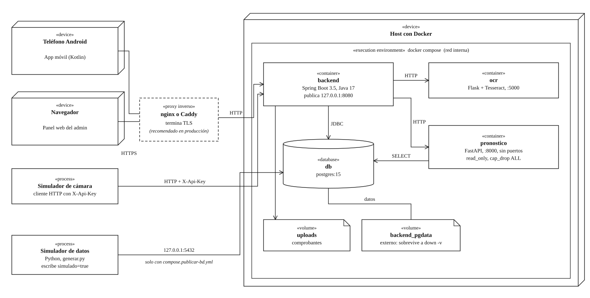

# Backend del parqueadero

API REST de un parqueadero de 7 cupos (6 carros y 1 moto). Cada usuario tiene un cupo fijo y una placa, paga cada mes con un comprobante que el administrador revisa, y entra o sale por una puerta que se abre cuando la cámara lee su placa. El backend también calcula analítica de ocupación, ingresos y mora, y expone un pronóstico de vacancia.

La puerta y la cámara son simuladas: no hay hardware conectado.


## Contenido

1. [Qué incluye](#qué-incluye)
2. [Arquitectura](#arquitectura)
3. [Modelo de datos](#modelo-de-datos)
4. [Seguridad](#seguridad)
5. [Flujos principales](#flujos-principales)
6. [Despliegue](#despliegue)
7. [Configuración](#configuración)
8. [Levantar con Docker Compose](#levantar-con-docker-compose)
9. [Verificar](#verificar)
10. [Datos simulados](#datos-simulados)
11. [Operación](#operación)
12. [Desarrollo sin Docker](#desarrollo-sin-docker)
13. [Pruebas y CI](#pruebas-y-ci)
14. [Documentación](#documentación)

## Qué incluye

| Parte | Dónde |
|---|---|
| API REST con roles ADMIN, USUARIO y SISTEMA, JWT, PIN con hash y bloqueo por intentos | `src/main/java`, ADR 0003 |
| Esquema versionado con Flyway (V1 a V4) | `src/main/resources/db/migration` |
| Pagos con revisión (PENDIENTE, APROBADO, RECHAZADO) y OCR del comprobante | ADR 0005 |
| Puerta y cámara simuladas, con registro de entradas y salidas por placa | ADR 0004 |
| Analítica: KPIs, ocupación, ingresos, mora, permanencia y resumen del usuario | `docs/contrato-analitica.md` |
| Pronóstico de vacancia, ocupación y llegadas (servicio FastAPI) | `pronostico/` |
| 12 meses de datos simulados y un historial demo para un usuario real | `simulador/` |
| Aviso de privacidad versionado (Ley 1581 de 2012) | `src/main/resources/legal` |

Tecnologías: Spring Boot 3.5 con Java 17, Spring Security con JWT (jjwt 0.11.5), Spring Data JPA sobre PostgreSQL 15, Flyway, un servicio OCR en Flask con Tesseract, un servicio de pronóstico en FastAPI con numpy y un simulador de datos en Python. Los consumidores son la app móvil (Android) y el panel web del administrador, que viven en otros repositorios.

## Arquitectura

El backend está organizado en capas dentro de `com.parqueadero.backend`: `controller`, `service` (interfaz más `Impl`), `repository` y `entity`. Los `dto` separan lo que entra y sale por la API, así que ninguna entidad JPA se expone directamente. `config/` tiene la cadena de seguridad, CORS y las propiedades de los servicios externos.

Toda petición pasa primero por tres filtros (límite por IP, clave de API y JWT) y después por las reglas por ruta de `SecurityConfig`. Cada controlador delega en su servicio; los servicios usan los repositorios de Spring Data y, cuando hace falta, el disco de comprobantes, el servicio OCR o el de pronóstico. El simulador de datos escribe directo en la base, sin pasar por la API.



## Modelo de datos

Son 10 tablas. Flyway es el único que crea o cambia el esquema y Hibernate solo lo valida (`ddl-auto=validate`). Las migraciones aplicadas no se editan: un cambio va en un archivo `V{n}__descripcion.sql` nuevo.

`usuario`, `vehiculo`, `pago` y `evento_acceso` tienen la columna `simulado`. Los índices únicos parciales solo aplican a las filas reales, así que el histórico simulado puede repetir teléfonos, placas y cupos sin chocar con los datos de verdad. `evento_acceso` es a la vez la bitácora de la puerta y la serie temporal que usan la analítica y el pronóstico.



La migración V2 carga los datos de referencia: el parqueadero, los cupos C1 a C6 y M1, las tarifas de 2025 y 2026 (carro 64.000 y 80.000 COP, moto 8.000 y 10.000 COP), la puerta y una cámara simulada.

## Seguridad

Hay tres roles. ADMIN y USUARIO se autentican con un JWT (HS256, `sub` = id y claim `rol`); SISTEMA es el simulador de cámara, que envía una clave en la cabecera `X-Api-Key` y solo puede registrar lecturas de placa.

El usuario no se registra solo. El administrador lo crea con su vehículo y su cupo, y recibe un código de validación de 8 caracteres que se muestra una sola vez y vence en 72 horas. El usuario activa la cuenta en la app con ese código, un PIN de 6 dígitos y la aceptación del aviso de privacidad. El PIN se guarda con BCrypt; cinco fallos seguidos bloquean la cuenta 15 minutos. Las cuentas que no existen se comportan igual (401 y luego 423), para que nadie pueda averiguar qué teléfonos están registrados.

No hay lista negra de tokens. Cambiar el PIN, activar la cuenta, generar un código nuevo, suspender o dar de baja actualiza `credenciales_cambiadas_en`, y el filtro rechaza cualquier JWT emitido antes de ese instante.



## Flujos principales

### Lectura de placa y apertura de la puerta

La cámara, la app y el panel usan el mismo método, `AccesoService.registrar`. Si el vehículo tuvo un evento en los últimos 60 segundos, devuelve ese evento y no crea otro: así no se duplica cuando la cámara lee dos veces o cuando el usuario pulsa "abrir" en la app y la cámara también lo lee. El tipo (ENTRADA o SALIDA) se deduce del último evento permitido del vehículo.

Para entrar, el usuario debe estar ACTIVO, sin baja y con un cupo del mismo tipo que el vehículo. La salida siempre se permite, aunque el usuario deba, porque no se retiene un vehículo adentro. Si el acceso se permite, la puerta queda abierta 10 segundos (`abierta_hasta`); no hace falta un proceso que la cierre. El administrador puede forzar la apertura con una observación obligatoria, y el evento queda con motivo `FORZADO_ADMIN`.



### Pago con comprobante y aprobación

El usuario sube una foto JPEG o PNG de hasta 5 MB. El tipo se reconoce por los primeros bytes del archivo, no por la extensión. El OCR se llama fuera de la transacción con un límite de 10 segundos; si falla, el pago se crea igual con `ocr_estado = FALLIDO` y el administrador lo revisa mirando la imagen. Un mismo comprobante (mismo SHA-256) no se acepta dos veces para el mismo usuario, y si coincide con el de otro usuario se marca como `posible_duplicado`.

Los comprobantes se guardan en el volumen `uploads` con nombre UUID y solo se entregan por `GET /api/pagos/{id}/comprobante`, con token, al administrador o al dueño del pago.



### Estados del usuario y del pago

El estado del usuario decide si la puerta se abre para entrar. VENCIDO y ACTIVO cambian solos: al aprobar un pago, y con un job diario a las 00:05 (hora de Bogotá) que vence a quien no tenga un periodo vigente más 5 días de gracia. El job también corre al arrancar, por si el servidor estuvo apagado a medianoche. SUSPENDIDO solo lo pone o lo quita el administrador.



## Despliegue

Docker Compose levanta cuatro contenedores en una red interna. Solo el backend publica un puerto, y por defecto solo en `127.0.0.1`. La base de datos, el OCR y el pronóstico no se ven desde fuera del host. El servicio de pronóstico no tiene autenticación, por eso no debe publicarse; corre con sistema de archivos de solo lectura y sin capacidades del kernel.



El backend habla HTTP. En producción debe ir detrás de un proxy inverso (nginx, Caddy o un balanceador) que termine HTTPS, sin exponer el puerto 8080 directamente, y con `LIMITE_IP_CABECERA` apuntando a la cabecera de IP real que pone el proxy.

## Configuración

Todo se configura con variables de entorno. Los secretos no van en git.

1. Copia `.env.example` a `.env` y reemplaza cada `change-me`. Los comentarios de `.env.example` dicen cómo generar cada secreto, por ejemplo `openssl rand -base64 48`.
2. `.env` está en `.gitignore`. No lo subas.
3. El backend no arranca si alguna credencial vale `change-me`, si `JWT_SECRET` o `CAMARA_API_KEY` (cuando se define) tienen menos de 32 bytes, o si `ADMIN_PASSWORD` (cuando se define) tiene menos de 12 caracteres. El error nombra la variable, nunca el valor.

| Variable | Obligatoria | Uso |
|---|---|---|
| `POSTGRES_DB`, `DB_USER`, `DB_PASSWORD` | sí | Base de datos; compose la crea con estos valores |
| `JWT_SECRET` | sí | Firma de los JWT, 32 bytes o más (`openssl rand -base64 48`) |
| `ADMIN_USERNAME`, `ADMIN_PASSWORD` | la primera vez | Crean el administrador si la tabla `administrador` está vacía (solo se guarda el hash BCrypt). Después se ignoran. Contraseña de 12 caracteres o más (`openssl rand -base64 18`) |
| `CAMARA_API_KEY` | para el simulador | Cabecera `X-Api-Key` del simulador de cámara. 32 bytes aleatorios o más (`openssl rand -hex 32`); vacía, el simulador queda deshabilitado |
| `CORS_ORIGENES` | no | Orígenes permitidos, separados por comas. Por defecto `http://localhost:5500,http://localhost:3000` |
| `SERVER_PORT` | no | Puerto publicado en el host (8080) |
| `SERVER_ADDRESS` | no | Fuera de Docker: `127.0.0.1` por defecto; `0.0.0.0` solo si hay que exponerlo en la LAN |
| `BIND_ADDRESS` | no | Interfaz del host donde compose publica el backend (`127.0.0.1` por defecto) |
| `GRACIA_DIAS` | no | Días de gracia (5). El backend y el pronóstico leen el mismo valor |
| `PRONOSTICO_URL` | sí (compose la fija) | URL del servicio de pronóstico; sin ella el backend no arranca |
| `LIMITE_IP_MAX_PETICIONES`, `LIMITE_IP_VENTANA_SEGUNDOS`, `LIMITE_IP_CABECERA` | no | Límite por IP en logins y activación (10 por minuto por defecto) |
| `DB_URL`, `OCR_SERVICE_URL`, `UPLOAD_DIR` | fuera de Docker | Compose ya los fija para los contenedores |
| `TESSERACT_CMD` | OCR fuera de Docker | Ruta de `tesseract.exe` en Windows |

`application.properties` trae valores por defecto que no son secretos: el JWT vence a las 4 horas para el admin y a las 12 para el usuario; el bloqueo es de 5 intentos y 15 minutos; el código de validación dura 72 horas; hay 5 días de gracia y el job de vencimiento corre a las 00:05; el anti-rebote es de 60 segundos y la puerta se abre 10; el comprobante pesa como máximo 5 MB.

## Levantar con Docker Compose

La base usa un volumen externo para que `docker compose down -v` no la borre. La primera vez:

```bash
docker volume create backend_pgdata
docker compose up -d --build
```

Servicios: `db` (Postgres, con healthcheck), `ocr` (solo red interna), `pronostico` (solo red interna, healthcheck en `/salud`) y `backend` (puerto `SERVER_PORT`, healthcheck en `/api/ping`). Al arrancar, Flyway aplica las migraciones y el backend crea el administrador:

- V1: esquema completo.
- V2: datos de referencia (7 cupos, tarifas, puerta y cámara simulada).
- V3: versión de credenciales para revocar tokens.
- V4: índice de eventos de acceso por fecha.

La base no se publica en el host. Para inspeccionarla, agrega por un momento `ports: ["127.0.0.1:5432:5432"]` al servicio `db`.

### Servicio de pronóstico

`pronostico/` lee la base y calcula vacancia, ocupación y llegadas (detalle en `pronostico/README.md`). Compose lo conecta por la red interna en `http://pronostico:8000`; el backend espera a que esté sano y lo expone a los ADMIN en `/api/analitica/pronostico/*` (contrato en `docs/contrato-analitica.md`).

- No tiene autenticación y no se publica en el host. No le agregues `ports` ni lo pongas detrás de un túnel: su único cliente es el backend.
- Usa las credenciales de base del `.env`, pero solo hace `SELECT` dentro de transacciones de solo lectura.
- Si se cae o tarda más de 8 segundos, esos endpoints responden 503. El resto de la API sigue funcionando.
- Pendiente: crear un rol de Postgres de solo lectura para este servicio. Hace falta gestionar su contraseña con una variable nueva, y por eso todavía no está hecho.
- Para retirarlo: quita el servicio `pronostico`, su `depends_on` y `PRONOSTICO_URL` de `docker-compose.yml`, y el controlador y las propiedades `pronostico.service.*` del backend. La propiedad es obligatoria, así que sin quitarla el backend no arranca.

## Verificar

```bash
docker compose ps
docker compose logs backend | grep -E "Successfully applied|Started"
curl http://localhost:8080/api/ping
```

`docker compose ps` debe mostrar los cuatro servicios arriba; `db`, `pronostico` y `backend` como healthy, y `pronostico` sin puertos publicados.

Login del administrador:

```bash
curl -X POST localhost:8080/api/admin/login -H "Content-Type: application/json" \
  -d '{"username":"...","password":"..."}'
```

Pronóstico con el token del administrador (sin token responde 401):

```bash
curl -H "Authorization: Bearer $TOKEN" "localhost:8080/api/analitica/pronostico/vacancia?incluirSimulados=true"
```

Lectura de placa desde el simulador de cámara:

```bash
curl -X POST localhost:8080/api/accesos/lecturas -H "X-Api-Key: $CAMARA_API_KEY" \
  -H "Content-Type: application/json" -d '{"placa":"ABC123"}'
```

## Datos simulados

`simulador/` genera 12 meses de usuarios, vehículos, pagos, entradas y salidas con `simulado=true` (detalle en `simulador/README.md`). Los listados de administración y la analítica los excluyen salvo que se pida `incluirSimulados=true`. El simulador solo borra y regenera lo simulado; nunca toca datos reales.

Como la base no está publicada, el simulador trae un override de compose que la publica en `127.0.0.1` mientras se ejecuta:

```bash
docker compose -f docker-compose.yml -f simulador/compose.publicar-bd.yml up -d db
pip install -r simulador/requirements.txt
python simulador/generar.py --limpiar
python simulador/verificar.py
docker compose up -d db      # vuelve a cerrar el puerto 5432
```

Para que la app muestre actividad, `python simulador/generar.py --limpiar --usuario-demo-placa PLACA` agrega al usuario real de esa placa 12 meses de pagos y visitas simulados, justo antes de su primer periodo real. `/api/pagos/mios` y `/api/accesos/mios` se los muestran al dueño, pero no cuentan como reales en la analítica ni afectan la puerta. Para quitarlos, ejecuta `generar.py --limpiar` sin la opción. `GET /api/accesos/mios?dias=90` (de 1 a 365, 30 por defecto) trae más historia de visitas.

## Operación

### Reiniciar la base de datos

Solo para un cambio de esquema incompatible, como el de la Fase 1 (ADR 0001):

1. Respalda la base y el volumen `uploads` (los comprobantes):
   ```bash
   docker compose exec -T db sh -c 'pg_dump -U "$POSTGRES_USER" -d "$POSTGRES_DB"' > ../backups/<fecha>.sql
   ```
2. `docker compose stop backend`
3. Borra el esquema:
   ```bash
   docker compose exec -T db sh -c 'psql -U "$POSTGRES_USER" -d "$POSTGRES_DB" -c "DROP SCHEMA public CASCADE; CREATE SCHEMA public;"'
   ```
   También puedes recrear el volumen: `docker compose down`, `docker volume rm backend_pgdata` y `docker volume create backend_pgdata`.
4. `docker compose up -d`. Flyway vuelve a aplicar V1 a V4.

### Aviso de privacidad

El texto vigente está en `src/main/resources/legal/aviso-privacidad-{version}.txt` y la versión en `legal.aviso-privacidad.version` (hoy `2026-10-14`). Para cambiarlo, crea el archivo de la versión nueva y sube la propiedad. El archivo anterior se conserva porque cada aceptación guarda la versión que el usuario aceptó. Antes de publicar el servicio hay que completar en el texto los datos del responsable del tratamiento: nombre, identificación, dirección y contacto.

### Apagar

`docker compose down` conserva la base y los comprobantes. `docker compose down -v` borra el volumen `uploads` pero no la base, que está en un volumen externo.

## Desarrollo sin Docker

Levanta solo la base con `docker compose up -d db` (publicando el puerto como se explica arriba), exporta las variables de `.env` más `DB_URL`, `OCR_SERVICE_URL`, `PRONOSTICO_URL` y `UPLOAD_DIR` (ruta absoluta fuera del repositorio) y ejecuta:

```bash
./mvnw spring-boot:run
```

## Pruebas y CI

- `./mvnw test` corre las pruebas unitarias (`*Test`: cálculo de periodo, placas, PIN y OCR). No necesitan Docker.
- `./mvnw verify` corre además las de integración (`*IT`) con MockMvc contra un PostgreSQL 15 real que levanta Testcontainers, así que necesita Docker. Cubren las migraciones con `validate`, la matriz de autorización por rol, IDOR, PIN y bloqueo, el ciclo alta, activación y login, los pagos (subida, tipo inválido, OCR caído, aprobación), los accesos (inferencia, anti-rebote, entrada repetida, salida siempre permitida), el vencimiento, la analítica y el proxy del pronóstico, el límite por IP y el historial propio (`/mios`).
- `pytest` en `pronostico/` y en `simulador/` no necesita Docker ni base de datos.
- Las pruebas usan sus propios valores; no leen `.env`.

`.github/workflows/ci.yml` corre en cada push y pull request: `./mvnw -B verify` con Java 17 (Testcontainers usa el Docker del runner) y, en otro job, `pytest` de `pronostico/` y `simulador/` con Python 3.12. El token del workflow solo tiene permiso `contents: read`.

## Documentación

- Contrato de la API para la app móvil: `docs/contrato-movil.md`
- Contrato de la analítica y el pronóstico: `docs/contrato-analitica.md`
- Diseño de la Fase 1: `docs/arquitectura/fase-1-modelo.md`, decisiones en `docs/adr/` y requisitos en `docs/requisitos/`
- Cambios de contrato para la app y el panel: `docs/cambios-de-contrato-fase-1.md`
- Diagramas de este README: `docs/diagramas/`
